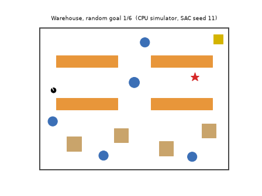
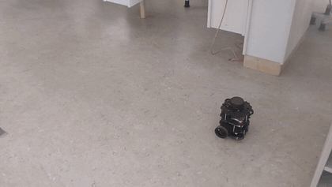

# TurtleBot Navigation Lab

An executable SAC training, checkpoint and evaluation pipeline with a deterministic
CPU navigation simulator and a separate ROS1 Noetic/Gazebo adapter.

The CPU pipeline has been executed, including real gradient updates, non-pickle
checkpoint loading and held-out evaluation across three training seeds. The
ROS1 Noetic/Gazebo container path has also been executed: a CPU-trained policy
reached 19/20 in one fixed Gazebo world ([results](docs/GAZEBO_RESULTS.md)), and
CI builds the container and runs a Gazebo smoke episode. No physical-robot result is claimed.

**Warehouse world:** an 8 m x 6 m warehouse with shelving aisles, pallets, barrels and
a column, where every episode has a randomly generated goal. SAC policies reach the
random goal in 40/50 held-out CPU episodes (two seeds; baseline 6/50), and a
CPU-trained checkpoint reached 6 of 8 random goals in Gazebo without retraining
([warehouse results](docs/WAREHOUSE_RESULTS.md)).



## Earlier hardware run



An earlier version of this project (before the current rewrite, using the
TD3/SAC networks kept in `legacy/`) was run on a physical TurtleBot3 Burger in
the lab; the clip above is from that run, shown at 2x speed. The current code has
no physical-robot mode, and every measured result in this README is from
simulation.

## Quick start without ROS

Use Python 3.10 or 3.11 and a new virtual environment. Install the CPU PyTorch build
from the official index if desired, then install this project:

```bash
python -m venv .venv
# Linux: source .venv/bin/activate
# Windows PowerShell: .venv/Scripts/Activate.ps1
python -m pip install torch --index-url https://download.pytorch.org/whl/cpu
python -m pip install .
python -m unittest discover -s tests -v
python scripts/verify_pipeline.py --out artifacts/first-check
```

The last command performs actual learning updates, saves a checkpoint, evaluates
it twice with the same scenarios, compares trajectory hashes, and verifies that
missing checkpoints are rejected. It is a software integration check, not a
navigation qualification. Output directories must be new, so failed or earlier
experiments cannot be silently overwritten.

## Train and evaluate

```bash
turtlebot-nav train --backend cpu --steps 30000 --seed 7 --out runs/train7
turtlebot-nav evaluate --backend cpu --policy runs/train7/policy.npz \
  --episodes 50 --seed 100000 --out runs/eval7
turtlebot-nav evaluate --baseline --episodes 50 --seed 100000 --out runs/baseline
```

SAC is the only supported learner. It includes replay sampling, twin Q losses,
actor updates, slowly updated target critics, tanh-corrected log probabilities,
automatic entropy temperature, and bounded episodes. DQN/DDPG/TD3/CrossQ files
are retained in `legacy/network_definitions` as historical architecture sketches,
not advertised as complete training algorithms.

Training produces configuration, optimization logs, completed-episode outcomes
and an inference checkpoint. Evaluation produces per-step trajectories,
success/obstacle-stop/timeout counts, source/model hashes and runtime versions.
Deterministic evaluation uses the actor mean. A missing checkpoint is an error;
an untrained policy is never silently substituted. Exact training resume is not
implemented, and an inference checkpoint must not be described as a resume file.

See [measured CPU results](docs/CPU_RESULTS.md), [Gazebo execution results](docs/GAZEBO_RESULTS.md), [architecture](docs/ARCHITECTURE.md)
and the frozen evaluation specification in `configs/qualification.json`.
Reproducibility is within a recorded runtime, not bitwise equality across every
PyTorch/platform release. Results describe finite, ideal-sensor2-D simulation.

## Warehouse world with random goals

Select it with `--world warehouse` on `train` and `evaluate` (default: `navigation`,
the original 5 m x 5 m arena, unchanged). Each episode samples a free start pose and a
goal at least 2 m away from its seed. Use a longer step limit for the larger area:

```bash
turtlebot-nav train --world warehouse --steps 60000 --max-steps 400 --seed 11 --out runs/wh-train11
turtlebot-nav evaluate --world warehouse --policy runs/wh-train11/policy.npz \
  --episodes 50 --seed 100000 --max-steps 400 --out runs/wh-eval11
```

The Gazebo world is generated from the simulator geometry, so both backends see the
same layout: edit `WAREHOUSE` in `simulation.py`, then run
`python scripts/generate_world.py` (CI checks they match). Launch it with
`roslaunch turtlebot3_smart_nav simulation.launch world:=warehouse`. A checkpoint
trained in one world needs `--allow-backend-transfer` to be evaluated in another.

## ROS1 Noetic and Gazebo

ROS1 Noetic is retained for compatibility with the original project. This is not
a ROS2 implementation. The Python core is independent of ROS. The optional
container pins a Python 3.8-compatible PyTorch/NumPy combination for Noetic;
the newer Python CPU path is tested separately.

```bash
docker compose build
docker compose up -d
# Wait ~1 minute for the TurtleBot spawn, then check the namespaced topics.
# `exec` bypasses the image entrypoint, so run commands through it to source ROS.
docker compose exec navigation /workspace/docker/entrypoint.sh rostopic list
docker compose exec navigation /workspace/docker/entrypoint.sh turtlebot-nav train --backend ros   --steps 10000 --out /results/gazebo-train
docker compose exec navigation /workspace/docker/entrypoint.sh turtlebot-nav evaluate --backend ros   --policy /results/gazebo-train/policy.npz --out /results/gazebo-eval
```
On Windows Git Bash, set `MSYS_NO_PATHCONV=1` first so container paths are not rewritten.

The provided launch creates a fixed world and a Burger model. The adapter uses
`/turtlebot_lab/cmd_vel`, `/turtlebot_lab/scan`, `/turtlebot_lab/odom` and Gazebo
services. It refuses a non-simulation ROS master. Pose, goal distance/bearing,
full-circle scan geometry, time alignment and fresh-message requirements are
explicit. Sensor/service failures stop the run; cleanup publishes zero velocity
and attempts to pause physics. There is no physical-robot mode.

A CPU-trained checkpoint is not automatically valid in Gazebo. An intentional
cross-backend experiment requires `--allow-backend-transfer` and is labelled in
its evidence. Physics/timing differences still need measured validation.

For a native ROS installation, build this repository as a Catkin workspace,
source `install/setup.bash`, and use `simulation.launch`. `run_agent.launch`
requires a new `out:=...` and optionally `policy:=...` for test mode.

## Verification and remaining limits

CI runs lint, unit/fault tests and an installed-package learning/evaluation smoke
pipeline, retaining evidence. The tests cover missing checkpoints, invalid
sensor inputs, scan remainder coverage, command cleanup, bounded waits,
termination/truncation semantics and reproducible evaluation. Mocked ROS tests
are not Gazebo tests. A green CI check does not prove a robot can navigate safely.

The container/Gazebo path has been executed (see
[Gazebo results](docs/GAZEBO_RESULTS.md): CPU-trained policy 19/20 in one fixed world;
[warehouse results](docs/WAREHOUSE_RESULTS.md): 6/8 random goals in the Gazebo warehouse).
Remaining work includes noisy sensors, moving obstacles, multiple held-out maps and any supervised hardware experiment. The CPU
world uses ideal ranges/pose and a simple unicycle; it does not model wheel slip,
dynamics, crowds or realistic sensor errors. All policy failures are reported.

The old external Drive downloader files remain historical references and are not
used by the pipeline. They do not establish compatible checkpoints or physical
results. No existing upstream licence or ownership is changed by this revision.

## Attribution

The original project references [tomasvr/turtlebot3_drlnav](https://github.com/tomasvr/turtlebot3_drlnav)
and [Reinis Cimurs's DRL navigation](https://github.com/reiniscimurs/DRL-robot-navigation).
[SAC equations](https://spinningup.openai.com/en/latest/algorithms/sac.html)
follow the published method; the implementation and finite experiments here are
not a reproduction of every result in that paper. Robot descriptions/assets and
ROS/Gazebo/PyTorch retain their respective upstream attribution.
