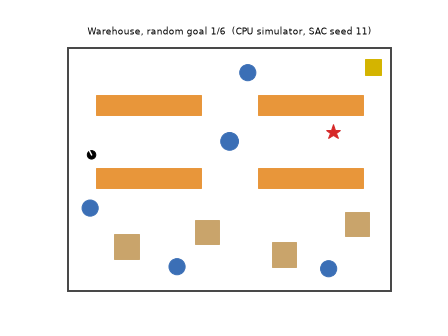

# Warehouse world: random goals among shelving, pallets and barrels

The warehouse world is an 8 m x 6 m walled area with four shelving racks (two long
aisles and a cross aisle), four pallets, five barrels and a column. Every episode
samples a new start pose and a new goal point anywhere in free space, at least 2 m
apart, from the episode seed. The CPU simulator geometry
(`turtlebot_nav.simulation.WAREHOUSE`) is the single source of truth: the Gazebo
world file is generated from it by `scripts/generate_world.py`, and a unit test
fails if the two drift apart. In Gazebo, a visual-only green marker (no collision,
invisible to the LiDAR) is moved to each sampled goal.



## Results

All evaluations use the same frozen held-out start/goal seeds (100000 onward),
deterministic actor-mean actions and at most 400 steps (80 s) per episode.
Training: SAC, 60,000 environment steps, `--max-steps 400`, default network.

| Policy | Trained in | Evaluated in | Episodes | Success | Obstacle stop | Timeout |
|---|---|---|---:|---:|---:|---:|
| SAC seed 7 | CPU warehouse (runtime A) | CPU warehouse | 50 | 40 | 8 | 2 |
| SAC seed 11 | CPU warehouse (runtime A) | CPU warehouse | 50 | 40 | 4 | 6 |
| Declared geometric baseline | – | CPU warehouse | 50 | 6 | 1 | 43 |
| SAC seed 11 | CPU warehouse (runtime B) | CPU warehouse | 50 | 41 | 5 | 4 |
| SAC seed 11, same checkpoint (`--allow-backend-transfer`) | CPU warehouse (runtime B) | **Gazebo warehouse** | 8 | **6** | 2 | 0 |

- Runtime A: Python 3.13, NumPy 2.5, PyTorch 2.15 (CPU), Linux.
- Runtime B: the repository container (Python 3.8, NumPy 1.24.4, PyTorch 2.2.2+cpu)
  on a Windows 11 host with Docker Desktop, headless Gazebo 11 with the GUI rendered
  into Xvfb for recording. Executed 26 November 2026.
- Runtime A and B produce different weights from the same seed, as documented for
  the original world; each row's checkpoint is identified by its hash in the run
  artifacts.

Observations:
- The learned policies reach a randomly generated goal in 80–82% of held-out CPU
  episodes; the geometric baseline mostly stalls in front of racks (43/50 timeouts).
- The CPU-trained checkpoint transferred to Gazebo without retraining and reached
  6 of 8 random goals; the other two ended in clearance stops (the robot came within
  0.15 m of an obstacle). Eight episodes is a small sample.
- The remaining failures are mostly clearance stops close to barrels and pallet
  corners. Longer training, more seeds and a curriculum are the obvious next steps.

## Reproduce

```bash
python scripts/generate_world.py --check
turtlebot-nav train --world warehouse --steps 60000 --max-steps 400 --seed 11 --out runs/wh-train11
turtlebot-nav evaluate --world warehouse --policy runs/wh-train11/policy.npz \
  --episodes 50 --seed 100000 --max-steps 400 --out runs/wh-eval11
turtlebot-nav evaluate --world warehouse --baseline --episodes 50 --seed 100000 \
  --max-steps 400 --out runs/wh-baseline
```

Gazebo (container):

```bash
docker compose build
docker compose run -d --name wh navigation roslaunch turtlebot3_smart_nav simulation.launch world:=warehouse gui:=false
docker exec wh /workspace/docker/entrypoint.sh turtlebot-nav evaluate --world warehouse --backend ros \
  --policy /results/wh-train11/policy.npz --allow-backend-transfer --episodes 8 --seed 100000 \
  --max-steps 400 --out /results/wh-gazebo
```

## Limits

One fixed warehouse layout, ideal ranges and pose in the CPU simulator, a simple
unicycle model, no moving obstacles (people, forklifts), no sensor noise and no
hardware run. The Gazebo figure is 8 episodes in one run. These results show that
the world, random-goal sampling, training and CPU-to-Gazebo transfer work end to end;
they do not show robustness to new layouts or real warehouses.
